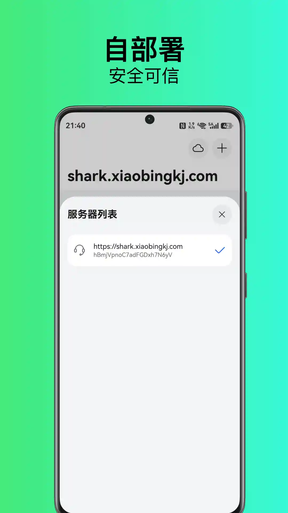
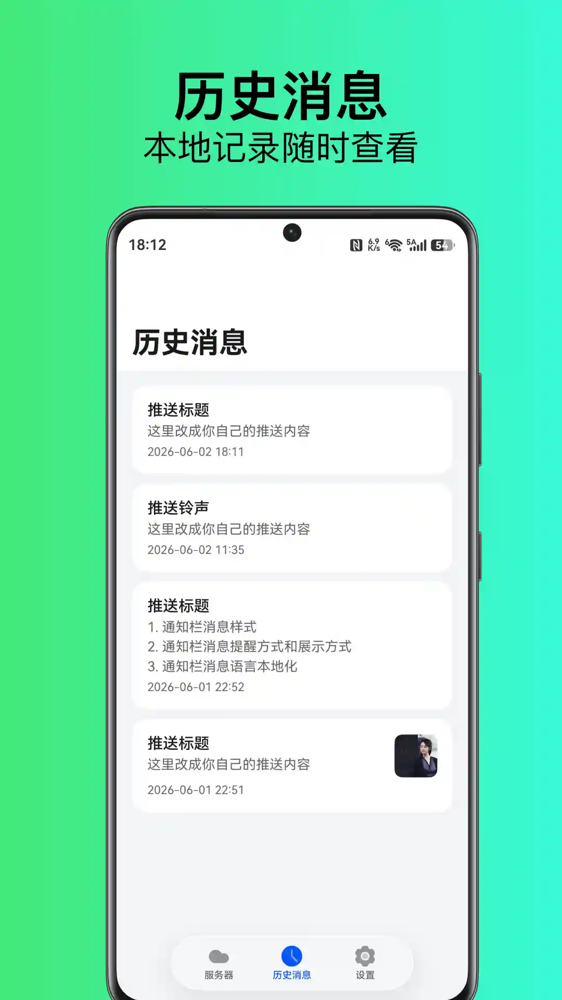

# Shark操作手册

## 一、相关文档

| 文档名称 | 指向资料 | 说明 |
| --- | --- | --- |
| 总体设计 | 《Shark总体设计》 | 说明软件整体功能、页面组成、运行环境和业务边界。 |
| 详细设计 | 《Shark详细设计》 | 说明设备注册、推送地址生成、历史记录存储等核心流程的处理规则。 |
| 测试案例 | 《Shark测试案例》 | 记录设备注册、推送发送、历史管理、服务器切换等功能的操作场景与预期结果。 |

## 二、软件说明

Shark 是一款运行于 HarmonyOS 手机上的远程推送通知客户端。软件以一条 HTTP 地址作为推送入口，用户只要在浏览器、命令行或脚本中访问这条地址，就能把文字消息实时发送到自己的手机通知栏，适合服务器监控告警、脚本执行结果通知、智能家居提醒、个人备忘等场景。

软件兼容开源 Bark 推送服务端协议，既可使用内置的默认服务器，也可接入用户自建的私有服务器，满足对数据自主性和隐私有要求的用户。全部功能围绕"生成推送地址、发送推送、查看与管理历史消息"展开，不需要注册第三方账号，也不需要部署额外的客户端组件，首次使用只需把手机登记到服务器即可。

使用软件时，用户主要完成三类操作：在服务器主页生成并复制推送地址；在历史消息页回看收到的推送；在设置页调整保存策略、查看设备信息或进入应用相关入口。本文档按上述页面和流程，逐一说明每个页面的用途、进入方式、可操作内容和操作结果。

## 三、功能特点

软件由服务器主页、历史消息、设置三个标签页组成，并包含添加私有服务器、铃声列表、更多应用、关于等二级页面，手机与平板均可使用，界面随屏幕尺寸自适应调整。

服务器主页是软件的核心操作区。首次使用先点击"注册设备"，应用获取系统推送凭据并完成设备登记，之后页面以卡片形式提供五种通知样式：普通推送、带铃声推送、多行文本、通知角标和大图标通知。每种卡片实时展示对应的推送地址，用户可以一键复制，也可以在浏览器中打开地址验证推送效果，地址中的标题、正文和样式参数都随输入即时更新。

历史消息页自动记录收到的每一条推送，按时间倒序排列，支持查看、左滑删除和二次确认；设置页还可以把全部历史记录导出为文本文件，通过系统分享面板发送到其他应用保存或整理。

设置页集中管理软件的各项配置：默认保存开关决定未指定归档参数的推送是否写入历史；设备令牌和构建信息可一键查看；常见问题、使用文档、开源项目、评分、更多应用、关于等入口均从该页进入。软件还集成小额捐赠功能，支持通过应用内购买向作者表达支持。

## 四、系统要求

| 系统要求 | 最低配置 | 推荐配置 |
| --- | --- | --- |
| 操作系统 | HarmonyOS 5.0.0(12) | HarmonyOS 6.0.2(22) 及以上 |
| 设备类型 | HarmonyOS 手机（Phone） | HarmonyOS 手机（Phone） |
| 网络环境 | 可访问推送服务器地址的网络连接 | 稳定的互联网连接 |
| 账号要求 | 华为账号（用于推送与支付） | 华为账号（用于推送与支付） |

使用推送功能需要设备已登录华为账号并允许应用发送通知；添加私有服务器时，设备需能访问对应服务器地址。若实际运行环境与本表不同，以实际使用情况为准。

## 五、首次启动与设备注册

打开软件后进入"服务器"标签页，页面中央显示"注册设备"圆形按钮。第一次使用软件时，需要先把当前手机登记到推送服务器，获得设备密钥后才能生成推送地址并接收推送。

点击"注册设备"按钮后，系统会请求通知权限，点击允许后应用完成设备登记，页面随即从按钮状态切换为普通推送、推送铃声、多行文本样式、通知角标、通知大图标五张卡片，每张卡片下方显示由服务器地址、设备密钥、标题和正文组成的推送地址，页面顶部标题显示当前使用的服务器地址。注册依赖网络连接，网络异常或未授予通知权限时，注册无法完成，页面停留在按钮状态，可检查网络和权限后重试。

【截图预留：请在此处插入"服务器主页（已注册设备）"页面截图。】

## 六、生成与测试普通推送

服务器主页第一张卡片用于生成普通推送。卡片上方是推送标题和推送内容输入区，默认显示示例文字，用户可以改成自己的内容；卡片下方实时显示拼接好的推送地址，右侧有两个图标，一个用于复制地址，一个用于在浏览器中打开。

需要推送消息时，先修改标题和正文，观察地址随输入即时更新，然后点击复制图标，把地址复制到剪贴板。之后在浏览器、电脑终端或任意能发起网络请求的工具中访问这条地址，手机通知栏会立即出现对应标题与正文的通知，软件同时自动保存一条历史消息，历史消息标签页的条目数随之更新。标题和正文允许留空，留空时推送使用默认文案；地址中的中文内容在浏览器打开时会自动编码，无需手工处理。

【截图预留：请在此处插入"普通推送地址生成"操作或结果截图。】

## 七、定制推送铃声、多行文本、角标与大图标

服务器主页的另外四张卡片用于定制通知的展示效果，分别是"推送铃声""多行文本样式""通知角标""通知大图标"。

推送铃声卡片中填写铃声名称，推送到达时按所选铃声播放提示音。不知道有哪些铃声时，点击卡片中的"查看所有铃声"进入铃声列表，试听后复制铃声名再回来填写；多行文本卡片用于一次推送多条内容，填写以竖线分隔的多行文字后，通知会逐行展示，适合列表类信息；通知角标卡片设置应用图标上的数字标记，可填写角标增加数或直接设定数；通知大图标卡片填写图片链接，通知中会展示这张图片作为大图标。四张卡片同样提供地址复制与浏览器打开功能，复制或打开地址即完成对应样式的推送。

使用时注意：铃声名称应使用软件内置铃声，填写未知名称时系统按默认铃声处理；角标的增加数与设定数同时为 0 时不生成角标参数；多行文本样式需要同时填写多行内容并确认样式参数生效。

【截图预留：请在此处插入"定制推送样式"操作或结果截图。】

## 八、服务器列表与切换

服务器主页右上角的列表图标打开服务器列表，以弹层形式展示全部已登记的推送服务器。每条服务器条目显示服务器地址和设备注册状态，地址相同的条目不会重复添加；当前正在使用的服务器条目右侧带勾选标记。

添加了多个服务器后，可以在这里切换当前使用的服务器：点击目标条目，弹层关闭，主页标题随即更新为所选服务器地址，推送地址中的服务器地址部分同步切换。列表中的服务器可能处于"未注册"状态，此时设备密钥保持原值；切换后应用会记住所选服务器，下次打开软件仍然使用它。

【截图预留：请在此处插入"服务器列表"弹层截图。】

## 九、添加私有服务器

服务器主页右上角的加号图标进入"添加私有服务器"页面。该页面用于把用户自建的推送服务器接入软件，实现推送服务的私有化部署。

页面提供"服务器地址"输入框，预填 https://，旁边有扫码图标。填写地址后点击右上角"保存"，应用先校验地址格式，再自动完成设备登记；保存成功后退回服务器主页，提示"保存成功"，新服务器自动加入服务器列表，主页标题切换为新服务器地址。也可以点击输入框旁的扫码图标，扫描服务器配置二维码，地址自动填入后再保存。页面下方的"查看服务端部署教程"链接会打开开源服务端的部署文档，供需要自建服务的用户参考。

地址必须以 http:// 或 https:// 开头且不能为空，否则提示"请输入正确的服务器地址"；地址末尾多余斜杠会被自动去除；服务器不可达或登记失败时，提示"注册失败"及原因。

【截图预留：请在此处插入"添加私有服务器"页面截图。】

## 十、铃声列表试听与复制

服务器主页"推送铃声"卡片中的"查看所有铃声"链接进入铃声列表页，页面按列表展示软件内置的 32 种通知铃声名称，每条条目右侧有音乐图标。

选择铃声时，点击任意铃声条目，软件立即播放该铃声试听，同时铃声名称自动复制到剪贴板，屏幕底部提示"复制成功"。确定使用某款铃声后，返回服务器主页，把铃声名称粘贴到推送铃声输入区即可。铃声全部来自软件内置资源，试听不消耗网络流量，离开页面后播放自动停止。

【截图预留：请在此处插入"铃声列表"页面截图。】

## 十一、历史消息查看与删除

主界面底部的"历史消息"标签页集中展示收到的全部推送记录。收到推送后点击通知，也会自动跳转到该页。列表按发送时间倒序排列，每条消息显示标题、正文、发送时间，带图片的推送同时显示缩略图；多行文本样式的消息逐行展示内容。

查看记录时直接上下滚动列表即可。删除某条消息时，在条目上向左滑动，出现红色删除按钮，点击后弹出确认对话框，选择"删除"才真正移除该条记录，选择"取消"则保留。删除结果会同步保存，重启软件后仍然生效。

【截图预留：请在此处插入"历史消息"页面截图。】

## 十二、历史消息导出

设置页"历史消息"分组中的"导出"条目用于把全部历史推送记录导出为文本文件，条目右侧显示当前已保存的消息条数。需要备份推送记录、把记录交给其他工具整理，或在更换设备前留档时使用。

点击"导出"条目，系统弹出分享面板，列出可接收文本的应用；选择目标应用（如文件管理、备忘录、即时通讯工具）后，按该应用的提示完成接收即可。导出内容为 JSON 文本，逐条包含标题、正文、发送时间、图片地址与样式信息，多行文本样式的消息其多行内容一并导出。没有任何历史消息时点击导出，会提示"没有可导出的消息"。导出只是生成一份分享副本，不会删除或改动本地历史记录。

【截图预留：请在此处插入"设置页导出历史消息"操作截图。】

## 十三、设置项与信息查看

主界面底部的"设置"标签页集中管理软件配置与信息入口，从上到下分为历史消息、信息、其他、捐赠几组。

"历史消息"分组提供"导出"条目和"默认保存"开关。默认保存开关决定推送地址未指定归档参数时，收到的推送是否自动写入历史消息；关闭后，这类推送只出现在通知栏，不进入历史记录。"信息"分组展示 Device Token 和 Github Run Id 两条信息，点击 Device Token 可复制推送令牌，点击 Github Run Id 可打开当前版本的自动化构建记录，用于确认版本由开源流程构建。"其他"分组提供常见问题、使用文档、开源项目、评分、更多应用、关于等入口，点击后分别打开对应网页或页面。"捐赠"分组提供"请我喝一杯奶茶"条目，点击后发起应用内购买，支持向作者捐赠。

使用时注意：默认保存开关只影响开关变更之后收到的推送；捐赠购买依赖华为账号与支付环境，未登录华为账号时无法完成支付。

【截图预留：请在此处插入"设置"页面截图。】

## 十四、关于页面

设置页"关于我们"条目点击后，从屏幕底部弹出"关于"窗口，展示软件图标、软件名称、作者微信公众号、ICP 备案号和版权声明。用户想了解软件归属、关注作者或核实备案信息时进入。

在弹出窗口中，点击公众号文字"范小兵"，公众号名称自动复制到剪贴板，并提示到微信中添加公众号即可关注；点击 ICP 备案号，系统浏览器打开工信部备案查询页面。窗口为大尺寸底部弹层，手机上全宽展示，查看完毕后点击窗口外部区域即可关闭，回到设置页。

【截图预留：请在此处插入"关于"弹层截图。】

## 十五、典型使用流程

首次使用软件时，先进入服务器页点击"注册设备"，允许通知权限后完成登记，页面显示五张推送地址卡片，复制推送地址即完成准备。日常推送时，在任意设备用浏览器、命令行或脚本访问该地址，手机通知栏立即收到推送，点击通知进入历史消息页查看详情。需要定制推送时，在服务器页修改标题、内容、铃声、角标、图片等参数，复制更新后的地址发送即可。使用多服务器时，先进入"添加私有服务器"输入自建地址或扫码，保存后回到服务器列表点选切换。

## 十六、常见问题解答

问题：如何用命令行发送一条推送？
解决方法：复制服务器主页生成的推送地址，在电脑终端用 curl 或任意 HTTP 请求工具访问该地址即可，例如 curl "https://shark.xiaobingkj.com/设备密钥/标题/内容"。

问题：为什么点击推送地址后手机没有收到通知？
解决方法：请依次检查：设备是否已注册（服务器主页是否显示五张推送卡片）；系统通知权限是否已授予；手机网络是否可用；若使用私有服务器，请确认服务器地址可达且设备已注册到该服务器。

问题：如何给推送设置自定义铃声？
解决方法：在服务器主页"推送铃声"卡片点击"查看所有铃声"，试听后点击铃声名称即可复制，再回到铃声输入区粘贴即可生成带铃声的推送地址。

问题：历史消息能保存多久？
解决方法：历史消息保存在设备本地，不设自动过期时间；默认所有推送都会保存，可在设置页关闭"默认保存"开关，此后未指定归档参数的推送将不再写入历史。

问题：可以自建服务器吗？
解决方法：可以。软件兼容开源 Bark 服务端协议，用户部署服务端后在"添加私有服务器"页面填写地址或扫码即可接入，之后在服务器列表中切换使用。

问题：设备令牌（Device Token）有什么用？
解决方法：Device Token 是华为推送服务为当前设备生成的推送令牌，是服务器向设备下发通知的凭据；设置页可查看并复制，一般无需用户手工处理。

## 十七、术语表

| 术语 | 解释 |
| --- | --- |
| 推送地址 | 由服务器地址、设备密钥、推送标题和正文等拼接而成的一条 HTTP 地址，访问该地址即可触发一条推送通知。 |
| 设备密钥 | 设备注册成功后服务器返回的唯一标识，用于在推送地址中定位目标设备，也可看作本机的"推送收件地址"。 |
| 推送令牌（Device Token） | 华为推送服务为设备生成的推送令牌，服务器据此把通知下发到指定设备。 |
| 推送服务器 | 接收推送请求并把消息转发到设备通知栏的服务端程序；软件内置默认服务器，也支持接入自建的兼容服务器。 |
| 多行文本样式 | 一种通知展示样式，将多条文本内容分行显示在通知中，适合展示列表类信息，通过 style=3 参数启用。 |
| 通知角标 | 应用图标右上角显示的数字标记，用于提示未读消息数量，可通过推送地址中的 badge 参数控制。 |
| 默认保存 | 设置页的一个开关，决定未在推送地址中指定归档参数的推送是否自动写入历史消息记录。 |
